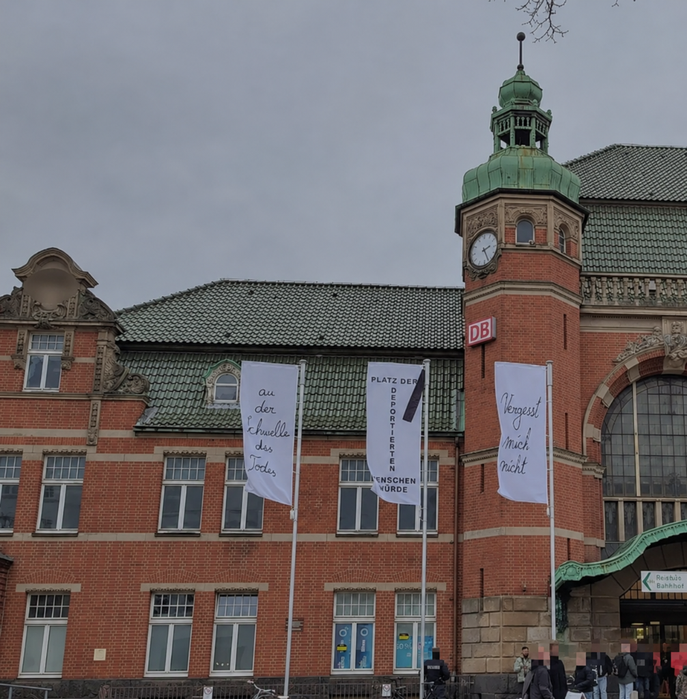

Aufruf zur Gedenkveranstaltung &amp; Mahnwache am 6. Dezember 2026: Zum 85. Jahrestag der Deportation von 92 jüdischen Männern, Frauen und Kindern vom Lübecker Hauptbahnhof ruft das Bündnis gegen Antisemitismus Lübeck zum gemeinsamen Gedenken auf.

---

### Gedenkveranstaltung & Mahnwache am Lübecker Hauptbahnhof

Kommt vorbei, schaut hin und haltet mit uns Wache – direkt am historischen Ort am Mahnmal der drei weißen Fahnen auf dem Bahnhofsvorplatz:

**Die Veranstaltungsdaten im Überblick:**
* **Datum:** Sonntag, 6. Dezember 2026
* **Uhrzeit:** 11:30 Uhr (Ende gegen 13:30 Uhr)
* **Ort:** Lübecker Hauptbahnhof (Direkt am Mahnmal der drei weißen Fahnen auf dem Bahnhofsvorplatz)
* **Anfahrt:** [Auf Google Maps anzeigen](https://www.google.com/maps/dir/?api=1&destination=L%C3%BCbeck+Hauptbahnhof+Bahnhofsvorplatz)
* **Hinweis für Anreisende aus dem Umland (z. B. aus Kiel):** Durch den Treffpunkt direkt am Hauptbahnhof ist die Anreise mit dem Zug problemlos möglich.

---

### 85. Jahrestag der Deportation vom Lübecker Hauptbahnhof

Am Sonntag, den 6. Dezember 2026, jährt sich ein dunkles Kapitel der Lübecker Stadtgeschichte zum 85. Mal: Am 6. Dezember 1941 wurden 92 jüdische Männer, Frauen und Kinder vom Lübecker Hauptbahnhof aus in das Ghetto nach Riga deportiert. Mitten am Tag, vor den Augen der Öffentlichkeit. Kaum jemand von ihnen überlebte den Holocaust.

Direkt auf dem Bahnhofsvorplatz erinnert das Mahnmal „Vor den Augen aller“ der Lübecker Künstlerin Ute-Friederike Jürß – die drei weißen Fahnen – an dieses Verbrechen. Doch im Alltag geht dieses Denkmal oft völlig unter; es wird kaum noch wahrgenommen oder schlicht als Fahrradständer zweckentfremdet.

<figure class="text-center my-4">
  
  <figcaption class="text-muted mt-2"><small><i>Mahnmal „Vor den Augen aller“ auf dem Lübecker Bahnhofsvorplatz (Klicken zum Vergrößern)</i></small></figcaption>
</figure>

### Gegen Antisemitismus, Desinformation und Schlussstrich-Forderungen

Gleichzeitig erleben wir in der Gegenwart eine erschreckende Zuspitzung: Rechtsextreme Vertreibungsfantasien werden unter dem Deckmantel der „Remigration“ wieder völlig schamlos propagiert und normalisiert. Auf den Straßen und im Netz wird nicht nur ungeniert das Existenzrecht Israels geleugnet, sondern ganz offen zur „globalen Intifada“ aufgerufen – was nichts anderes bedeutet als die weltweite Jagd auf jüdische Menschen und die Vernichtung jüdischen Lebens überall.

Dazu kommt eine perfide Welle von Desinformation und Täter-Opfer-Umkehr sowie eine zunehmende Schuldabwehr von verschiedensten Seiten, die unter dem Vorwand, man müsse sich endlich von der „Schuld der Geschichte“ befreien, einen Schlussstrich unter das Erinnern ziehen will. Antisemitismus ist präsenter, aggressiver und lauter denn je.

### „Nie wieder“ fordert Handeln im Hier und Jetzt

Für uns ist klar: „Nie wieder“ darf keine hohle Phrase sein. Gedenken fordert Handeln im Hier und Jetzt.

<blockquote class="blockquote my-4 p-3 bg-light rounded" style="border-left: 5px solid #0056b3;">
  
„Ihr habt keine Schuld an dem, was passiert ist. Aber ihr macht euch schuldig, wenn es euch nicht interessiert.“

  <footer class="blockquote-footer mt-2">Esther Bejarano, Holocaust-Überlebende</footer>
</blockquote>

Deshalb rufen wir alle Demokratinnen und Demokraten – aus Lübeck und dem Umland – dazu auf, am 6. Dezember mit uns ein Zeichen zu setzen! Wir wollen das Vergessen direkt am historischen Ort durchbrechen, die historische Wahrheit verteidigen und durch unsere Präsenz ein unübersehbares Zeichen gegen aktuellen Antisemitismus, Rassismus und jede Form von Menschenfeindlichkeit setzen.

**Macht mit und setzt mit uns ein Zeichen für die Würde aller Menschen!**

### Weitere wichtige Gedenkveranstaltungen in Lübeck an diesem Tag

Unsere Mahnwache versteht sich als Auftakt und Ergänzung zu den bestehenden Gedenkangeboten in der Lübecker Innenstadt. Im Anschluss besteht die Möglichkeit, diese Veranstaltungen individuell zu besuchen:

* **14:00 Uhr \| Stadtspaziergang „Jüdisches Leben in Lübeck“:** Start am Holstentor, Feldseite (Veranstalter: Fachstelle Erinnerungskultur; Anmeldung unter [erinnerungskultur@luebeck.de](mailto:erinnerungskultur@luebeck.de)).
* **16:00 Uhr \| Offizielle Gedenkveranstaltung:** Gedenken zum 85. Jahrestag der Deportation am Mahnmal für die Opfer des Nationalsozialismus (Parade 12), ausgerichtet von der Jüdischen Gemeinde Lübeck, dem Haus der Kulturen, der Geschwister-Prenski-Schule und der Initiative Stolpersteine.

---

**Initiatoren & Organisatoren:**  
**Bündnis gegen Antisemitismus Lübeck**
